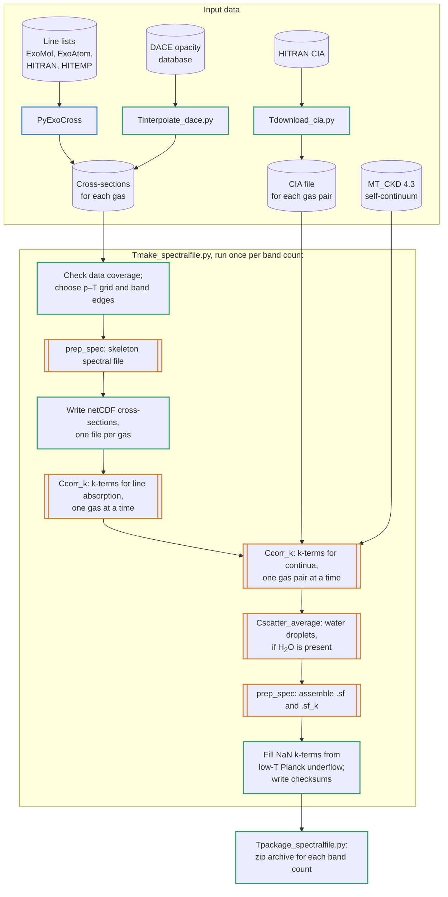

# Building spectral files

The newer [PROTEUS spectral files](../Reference/proteus_spectral_file_reference.md) are built with `spectraltools`, a set of Python scripts in the [`spectraltools/`](https://github.com/FormingWorlds/SOCRATES/tree/main/spectraltools) folder of this repository. They are not part of the Met Office distribution of SOCRATES and are distributed under the 3-Clause BSD Licence.

`spectraltools` does not calculate line absorption itself. It reads cross-sections that were computed beforehand at high spectral resolution, writes them in the netCDF format that `Ccorr_k` reads, and then runs the compiled SOCRATES tools `prep_spec`, `Ccorr_k` and `Cscatter_average`. This keeps the slowest step, turning a line list into cross-sections, separate from the fitting of k-terms.

---

## Steps

The diagram outlines the pipeline. Cylinders are data, boxes with double sides are compiled SOCRATES programs, and plain boxes are Python steps. The outline colour shows which code carries out each step: PyExoCross (blue), `spectraltools` (green) or SOCRATES (orange).



1. Compute or download cross-sections for each gas, and download the HITRAN collision-induced absorption (CIA) files.
2. Set the gases, file name and other parameters in `Tmake_spectralfile.py`.
3. Check that the data cover the requested pressures, temperatures and wavenumbers, and choose the pressure–temperature grid.
4. Choose the band edges.
5. Write a skeleton spectral file and the pressure–temperature files with `prep_spec`.
6. Write one netCDF cross-section file per gas.
7. Fit k-terms for line absorption, one gas at a time, with `Ccorr_k`.
8. Fit k-terms for the continua, one gas pair at a time, with `Ccorr_k`.
9. Fit water droplet scattering properties with `Cscatter_average`, if H<sub>2</sub>O is present.
10. Assemble the spectral file with `prep_spec`, fill the NaN k-terms caused by underflow of the Planck function at low temperatures, and write checksums.
11. Package the files into a zip archive.

`Tmake_spectralfile.py` carries out steps 3 to 10. `Tmake_spectralfile_bands.py` runs it for several band counts in turn and packages each result (step 11).

---

## Input data

### Cross-sections

Cross-sections for each gas go in `spectraltools/data/<source>/<gas>/`. `Tmake_spectralfile.py` sets a default source and per-gas exceptions:

```python
source = "exocross"
vol_source = {"VO":"dace", "CH4":"dace", "NH3":"dace"}
```

- **`exocross`**: `.xsec` or `.xsec.bz2` files, one per pressure and temperature, with the pressure and temperature in the file name (`P<p>bar`, `T<t>K`). They are read from `data/exocross/<gas>/<line list source>/`, where the line list source is `ExoMol`, `ExoAtom`, `HITRAN` or `HITEMP`. If more than one of these folders exists, the first in that order is used and a warning is logged.
- **`dace`**: binary files at 0.01 cm⁻¹ resolution, downloaded from the [DACE opacity database](https://dace.unige.ch/opacityDatabase/) with `Tinterpolate_dace.py`. This script asks DACE (through the `dace-query` package) for cross-sections interpolated to the target pressures up to 10³ bar, and to those target temperatures that lie within the line list's temperature range. DACE computes its cross-sections with HELIOS-K.

Readers for HITRAN `.xsc` files and ExoMol `.sigma` files also exist, but are not used by the Generation III files.

### PyExoCross cross-sections

For the files made in October 2026, the `exocross` cross-sections were computed with [PyExoCross](https://github.com/Beryl-Jingxin/PyExoCross) ([Zhang et al. 2024](https://doi.org/10.1093/rasti/rzae016)), a Python version of ExoCross ([Yurchenko et al. 2018](https://doi.org/10.1051/0004-6361/201732531)). The calculations were run from a fork, [nichollsh/PyExoCross](https://github.com/nichollsh/PyExoCross), whose script `tools/generate_xsec_inp_config.py` writes an input file for each species from a template. The script changes only the species, data set, quantum-number labels and whether the uncertainty filter is used (on only where the line list gives uncertainties); every other setting comes from the template. The templates in the fork (commit `9c86b5f`) set:

| Setting | Template value |
|---------|----------------|
| Calculation | Absorption cross-sections in local thermodynamic equilibrium |
| Wavenumber range | 10–50 000 cm⁻¹ |
| Grid | Bins of 0.025 cm⁻¹ |
| Temperatures | The 57 temperatures of the target grid below (25–5000 K) |
| Pressures | The 18 pressures of the target grid below (10⁻⁵–10⁴ bar) |
| Line profile | Voigt: `HumlicekVoigt` (ExoMol and HITRAN templates) or `SciPyVoigt` (ExoAtom template) |
| Line-wing cut-off | 40 cm⁻¹ (ExoMol and HITRAN templates), 100 cm⁻¹ (ExoAtom template) |
| Pressure broadening | `Default` with ratio 1.0. The PyExoCross documentation defines this as a Lorentzian half-width of 0.07 and a temperature exponent of 0.5 for all lines; for HITRAN and HITEMP input it means air broadening. |
| Intensity threshold | Minimum line intensity 10⁻³² cm molecule⁻¹ |
| Uncertainty filter | Maximum uncertainty 0.1 cm⁻¹, applied only where the line list gives uncertainties |

The input files for each species are not in the repository, so these values have not been checked against them. They differ from the templates at least in the cut-off: the cut-offs used were 25 cm⁻¹ for H<sub>2</sub>O, 100 cm⁻¹ for H<sub>2</sub>, Na, K and Fe, and 40 cm⁻¹ for the other PyExoCross gases (see the [line opacity table](../Reference/proteus_spectral_file_reference.md#line-opacities)). The template grid matches the target grid and the `dnu` of 0.025 cm⁻¹ used by `Tmake_spectralfile.py`.

### Collision-induced absorption

`Tdownload_cia.py` downloads one HITRAN CIA file per gas pair into `data/cia/<pair>.cia`. It tries HITRAN's `main` folder first and then its `alternate` folder. The water vapour self-continuum is not taken from HITRAN CIA but from the MT_CKD file in `data/continua/` (see [Continua](#continua)).

---

## Settings

The parameters are set at the top of `main()` in `Tmake_spectralfile.py`:

| Parameter | Value used | Meaning |
|-----------|------------|---------|
| `vols` | e.g. `["H2O", "CO2", "CO", "O2", "SO2", "OCS", "S2"]` | Gases with line absorption; the first is the most significant absorber |
| `alias` | e.g. `"Breezehome"` | Name of the spectral file |
| `nband` | 32, 64, 128, 256 or 2048 | Number of bands |
| `method` | 3 | Band selection method (see [Band edges](#band-edges)) |
| `numin`, `numax` | 10, 50 000 cm⁻¹ | Wavenumber range |
| `dnu` | 0.025 cm⁻¹ | Wavenumber step of the netCDF files |
| `maxpath` | 10³ kg m⁻² | Default maximum absorber path for `Ccorr_k` (also used for continua, in kg² m⁻⁵) |
| `vol_maxpath` | 10 kg m⁻² for SiO, TiO, VO, MgO, Na, K and Fe | Per-gas maximum absorber path |
| `drops` | `True` | Add water droplet scattering when H<sub>2</sub>O is present |
| `UV` | `False` | Add separate UV cross-sections (not used) |
| `preNC` | `True` | Reuse netCDF files from an earlier run of the same alias |

The target grid has 18 pressures and 57 temperatures, 1026 points in all:

- pressures: 10⁻⁵ and 10⁻⁴ bar, then every half decade from 10⁻³·⁵ to 10⁴ bar, rounded to two significant figures (3.2 × 10⁻⁴, 10⁻³, 3.2 × 10⁻³, …);
- temperatures: 25 K; 100–325 K every 25 K; 350–950 K every 50 K; 1000–4000 K every 100 K; 4500 K and 5000 K.

---

## Data coverage and pressure–temperature grid

For each gas, the script reads one cross-section file to find its wavenumber range, and lists the pressures and temperatures of all its files. Where the target grid extends more than 1 % beyond a gas's data, a warning is logged and the nearest available point is used for that gas. For example, the DACE data for CH<sub>4</sub> and NH<sub>3</sub> stop at 10³ bar and at 2500 K and 1900 K respectively. The script stops with an error if the target grid extends beyond the data of all gases combined. The wavenumber range is narrowed to the range covered by the data.

The last gas in `vols` that uses the default source is the reference gas. Its files set the pressure–temperature grid: each target temperature is replaced by the nearest temperature in its files, and each target pressure by the nearest pressure in logarithmic distance (`ptf.best_pt`). The reference gas's files must form a rectangular grid, and the code refuses target grids of 2000 points or more.

---

## Band edges

`spectral.best_bands` places the band edges in wavenumber by one of several methods:

| Method | Band spacing |
|--------|--------------|
| 0 | Linear |
| 1 | Logarithmic |
| 2 | One band for wavelengths longer than 40 µm, linear spacing elsewhere |
| 3 | Linear spacing for wavelengths longer than 40 µm, logarithmic spacing elsewhere |
| 4 | Linear for wavelengths longer than 40 µm, logarithmic between 40 µm and 400 nm, and logarithmic again (with a separate share of the bands) shortward of 400 nm |
| 5 | Set by the weighted sum of Planck functions at 180 K, 1800 K and 6500 K, so that each band holds an equal share of their cumulative distribution |
| 9 | The 318 bands of the legacy spectral files |

The Generation III files use **method 3**. Of the `nband + 1` edges, 12 % (rounded down) are spaced linearly between the lowest wavenumber and 250 cm⁻¹ (40 µm), and the rest logarithmically from 250 cm⁻¹ to the highest wavenumber. Each edge is then moved to the nearest wavenumber in the reference gas's data. The log lists the resulting bands.

---

## Skeleton spectral file

`spectral.create_skeleton` runs `prep_spec` to write `<alias>_skel.sf`, which holds the band limits, the absorbers (by their SOCRATES identifiers from `gas_list_pcf.F90`) and the continua. A continuum is included for every supported pair (`utils.cia_pairs`) whose two gases are both present. No aerosols are added, and no absorbers or continua are yet assigned to bands.

It also writes two pressure–temperature files for `Ccorr_k`:

- `<alias>_pt_lbl.dat`, for line absorption: every pressure combined with every temperature of the grid;
- `<alias>_pt_cia.dat`, for the continua: a single pressure, the grid pressure closest to 1 bar, with every temperature. When H<sub>2</sub>O is present, temperatures below 50 K are left out, because the Planck weights used for MT_CKD underflow there. All pairs share this grid.

---

## netCDF cross-section files

For each gas, `netcdf.write_ncdf_from_grid` writes `<alias>_<gas>.nc`:

1. Each point of the grid is matched to the gas's closest file, by the combined relative difference in pressure and temperature (`ptf.map_ptf`). The matches are written to `<alias>_<gas>_ptf.csv`.
2. Each file is read and cut to the wavenumber range. DACE data are moved from their 0.01 cm⁻¹ grid onto multiples of `dnu` by taking the nearest point, not by interpolation, so that narrow lines are not smeared. PyExoCross data already lie on a 0.025 cm⁻¹ grid.
3. Cross-sections are converted from cm² per molecule to m² kg⁻¹ using the molar mass, and values below a small floor (10⁻⁴⁵ cm² g⁻¹, or for DACE the smallest positive value in the file) are raised to it.
4. The file holds the variables `p_calc` (Pa), `t_calc` (K), `nu` (m⁻¹) and `kabs` (m² kg⁻¹, one row per pressure–temperature point).

All gases must have the same wavenumber step. With `preNC = True` an existing file is reused, since it does not depend on the number of bands; the 2026 builds reused files written by an earlier run.

---

## Line absorption

`spectral.calc_kcoeff_lbl` runs `Ccorr_k` once per gas:

```
Ccorr_k -F <alias>_pt_lbl.dat -R <first band> <last band> -l <gas id> <maxpath> \
        -tt 1.000e-40 -t 5.0e-03 -ns 500 -s <alias>_skel.sf +p -lk -k \
        -o <alias>_<gas>_lbl.sf_k -m <alias>_<gas>_mon.log -L <alias>_<gas>.nc \
        -sm <alias>_<gas>_map.nc -np 40
```

| Option | Meaning |
|--------|---------|
| `-R` | Only the bands that lie entirely within the gas's data |
| `-l gas maxpath` | Line absorption for this gas. Transmission errors are considered for absorber paths up to `maxpath` (10³ kg m⁻², or 10 kg m⁻² for the gases listed above) |
| `-t 5.0e-03` | Use as many k-terms as needed to keep the RMS transmission error below 5 × 10⁻³ (`CCORRK_LBL_TOLTYPE = 't'`, `CCORRK_T_RMSERR` in `src/spectral.py`). The alternatives are a fixed number of terms (`-n`) or binning by the pressure where scaling peaks (`-b`) |
| `-tt 1.000e-40` | Threshold on the summed absorption below which a band is treated as transparent |
| `-ns 500` | Maximum number of sub-bands per band in the k-term fit; the fit stops at this limit even if the tolerance is not met |
| `+p` | Planckian weighting |
| `-lk` | Look-up table in pressure and temperature, rather than a scaling function |
| `-k` | Passed for every gas; the `Ccorr_k` manual page describes it as an adjustment for use with the CKD continuum |
| `-L` | The netCDF cross-section file from the previous step |
| `-sm` | Save the mapping from wavenumber to g-space; the H<sub>2</sub>O mapping is reused for the H<sub>2</sub>O-H<sub>2</sub>O continuum |

The run stops if the `Ccorr_k` log does not report a normal end or reports a failure to converge.

---

## Continua

`spectral.calc_kcoeff_cia` runs `Ccorr_k` once per gas pair present, with the same tolerance type and value as for line absorption, the continuum pressure–temperature file, a maximum path of 10³ kg² m⁻⁵ (`-ct`) and an integration step equal to the netCDF wavenumber step (`-i`, 2.5 m⁻¹).

**H<sub>2</sub>O-H<sub>2</sub>O** uses the MT_CKD 4.3 self-continuum, `data/continua/absco-ref_wv-mt-ckd4p3.nc` (`MT_CKD_VERSION = "mt_ckd4p3"`). The same file is given twice to `-e`, as the `Ccorr_k` manual page requires for this format, and `Ccorr_k` applies the temperature exponents stored in it. According to the comments in `src/spectral.py`, the file holds coefficients without the radiation term ν tanh(hcν/2kT), which `Ccorr_k` applies itself. Only bands lying entirely within the MT_CKD table (up to 20 000 cm⁻¹ for this file) receive the continuum. The call adds `-c 2500` (a line cut-off of 2500 m⁻¹, i.e. 25 cm⁻¹, the value the manual page specifies for use with CKD), `-tt`, `-ns`, and `-lm` with the H<sub>2</sub>O mapping saved in the previous step.

**Other pairs** use HITRAN CIA files. Before use, `spectral.write_cia_fixed` rewrites each file in the fixed columns that `Ccorr_k` reads. Some HITRAN files write the wavenumber limits and temperature as integers, which `Ccorr_k` would read with an implied decimal point (296 K as 2.96 K); some write five-digit mantissas, which lose the last digit of the exponent; and some have left-aligned columns. The log records how many data sets (one per temperature or wavenumber range) were rewritten for each pair. The CO<sub>2</sub>-H<sub>2</sub>O data exist only at 296 K and are used at all temperatures.

---

## Water droplets

If `drops = True` and H<sub>2</sub>O is among the gases, `spectral.calc_waterdroplets` runs `Cscatter_average` on `data/cloud/scatter_drop_type5`, with thick averaging (`-t`), Planckian weighting at 250 K, one moment of the phase function, and a Padé fit (fit type 5) for a material density of 1000 kg m⁻³. The result is added to block 10 as droplet type 5, with the range of validity 1.5 × 10⁻⁶ to 5.0 × 10⁻⁵ given to `prep_spec`. Snowline and Breezehome contain these data; Cliffshade and Volenfell do not, as they have no H<sub>2</sub>O.

---

## Assembly and NaN check

`spectral.assemble` runs `prep_spec` on the skeleton file to add the k-terms for each gas (block 5), the continuum k-terms and the droplet data, giving `<alias>.sf` and its look-up tables `<alias>.sf_k`. It adds no thermal source function, solar spectrum, Rayleigh scattering, aerosol or ice data; the 2026 files contain blocks 0, 1, 4, 5, 8, 18 and 19, plus block 10 where droplets are included.

Both files are then searched for NaN values. These come from `Ccorr_k`, which gives NaN k-terms at low temperatures because the Planck function it uses to weight them underflows there: exp(−hcν/kT) becomes too small for double precision, which at 25 K happens above roughly 12 000 cm⁻¹. In `.sf_k`, `spectral.fill_nan_lookup` replaces each NaN by linear interpolation in temperature along its row of the look-up table (same band, gas, k-term and pressure), keeping the outermost valid value beyond the ends; the code comments state that this matches how SOCRATES interpolates the table. A row with no valid values is set to zero, and any NaN left after that is replaced by zero. The log reports how many values were filled or set to zero. Every 2026 build had NaN values filled by interpolation; none reported values set to zero, and the final files contain no NaN.

---

## Checksums and packaging

`spectral.assemble` writes BLAKE2b checksums of `<alias>.sf` and `<alias>.sf_k` to `<alias>.chk` and `<alias>.chk_k`. `Tcalc_checksum.py <file>` computes the same checksum to check a downloaded file.

`Tmake_spectralfile_bands.py` runs `Tmake_spectralfile.py` for each requested band count (by default 32, 64, 128, 256 and 2048), using the same gases and settings. The runs share an alias, so each clears the output of the previous one, except the netCDF files when `preNC = True`. After each run, `Tpackage_spectralfile.py` writes `<target>/<alias>/<nband>/<alias>.zip`, holding the spectral file, its look-up tables, the logs, the checksums, the plots of each gas's cross-section, and a copy of `Tmake_spectralfile.py` as `<alias>_Tmake_spectralfile.py`. It then tests the archive.

!!! warning
    The copy of `Tmake_spectralfile.py` in each archive is the script as it was when the archive was written, which may differ from the script that made the file. For the 2026 files the copies do not always show the gases of the file they accompany. The log in the same archive records the settings actually used.

---

## Running the pipeline

With SOCRATES compiled, `. ./set_rad_env` sourced and an `output/` folder (or link) inside `spectraltools/`:

```bash
cd spectraltools
python Tdownload_cia.py                 # HITRAN CIA files into data/cia/
python Tinterpolate_dace.py             # DACE data for one gas; edit the parameters first
# edit the parameters in Tmake_spectralfile.py
python Tmake_spectralfile_bands.py <target folder> --nband 32 64 128 256 2048
```

`Tmake_spectralfile.py` can also be run on its own to make a single file with the band count set in the script.

---

## References

- PyExoCross: Zhang, Tennyson & Yurchenko 2024, RAS Techniques and Instruments 3, 257, [doi:10.1093/rasti/rzae016](https://doi.org/10.1093/rasti/rzae016).
- ExoCross: Yurchenko, Al-Refaie & Tennyson 2018, A&A 614, A131, [doi:10.1051/0004-6361/201732531](https://doi.org/10.1051/0004-6361/201732531).
- The references for the line lists, the continua and the databases are on the [PROTEUS spectral files](../Reference/proteus_spectral_file_reference.md#opacity-data-and-references) page.
